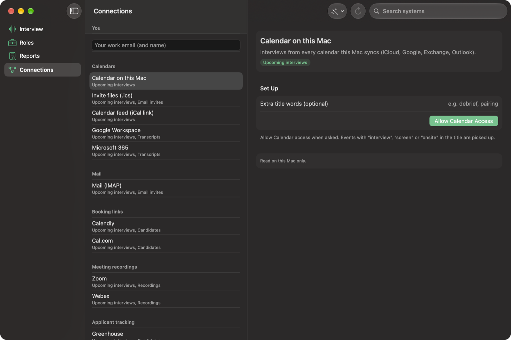
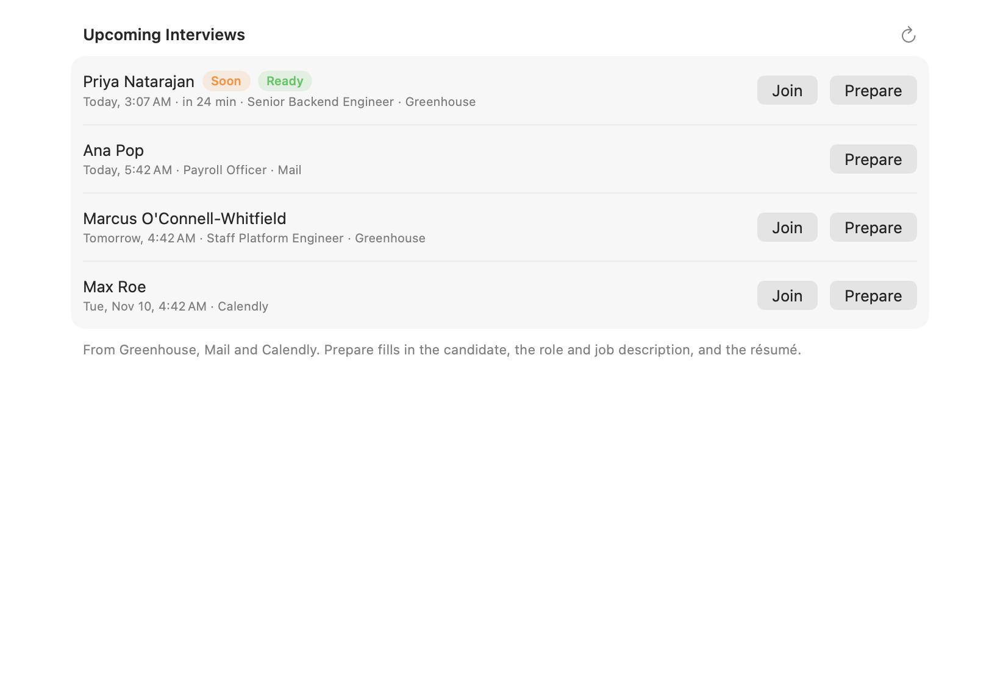
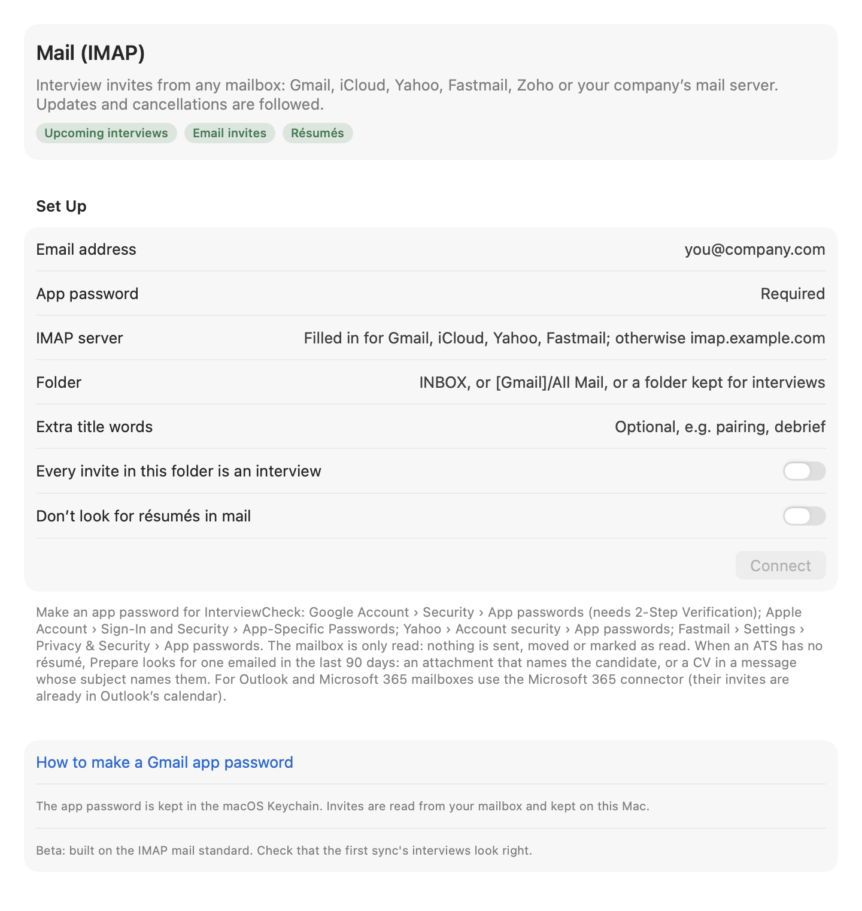
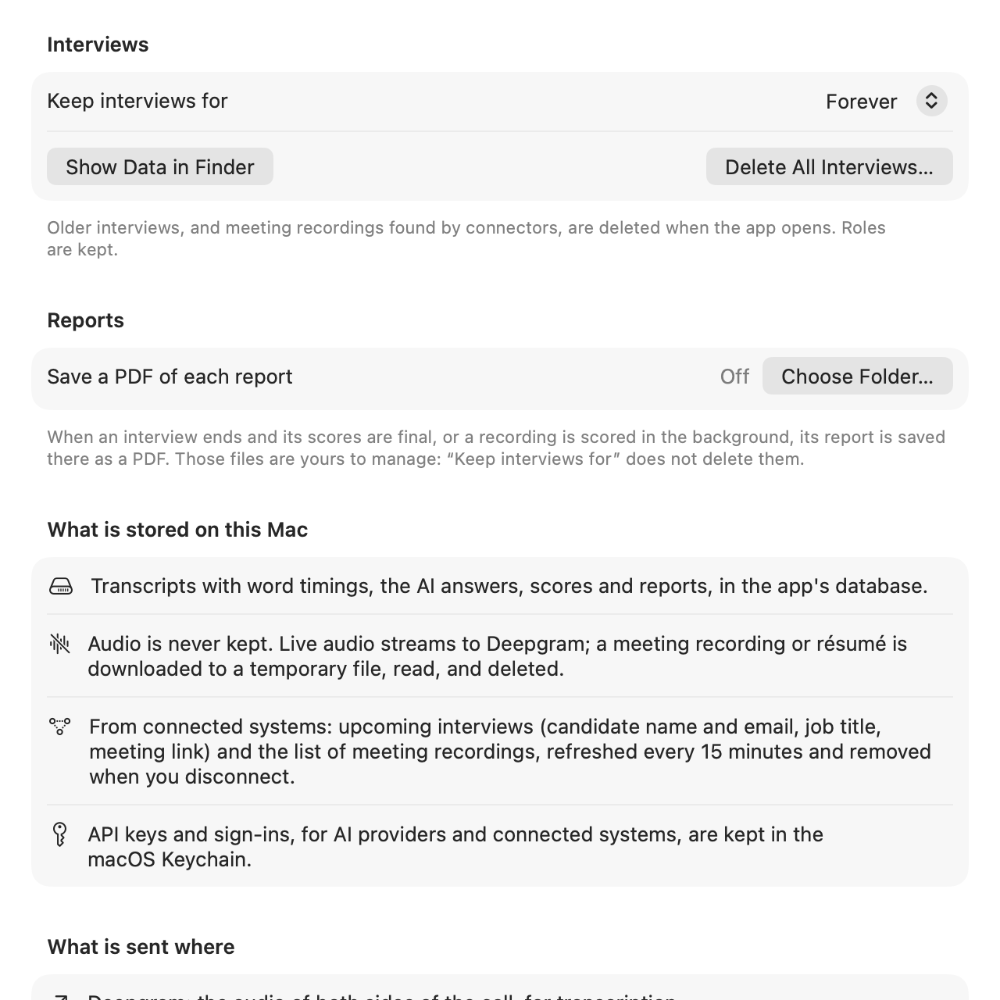

# Overnight work, 7–8 November 2026

Everything is committed in the local git repository at `~/InterviewCheck` and nothing
was pushed or sent anywhere. The installed app (`~/Applications/InterviewCheck.app`) is
the latest Release build (installed 03:10), and `build/InterviewCheck-1.0.0.dmg` (about 8 MB) packages it
for another Mac. It is not notarized yet, so macOS warns before opening it there. The full step-by-step log is in [native-app-plan.md](native-app-plan.md).

## What it is now

- **A normal Mac app.** It has one main window with the standard close, minimize and
  zoom buttons, which can be moved and resized. A sidebar holds Interview, Roles,
  Reports and Connections (⌘1–⌘4). It also has a Settings window (⌘,), full menus, a
  menu bar item while an interview is live, its own icon, a Dock menu and Shortcuts
  actions. Nothing is hidden from screen sharing.
- **A scalable codebase.**
  - The module is renamed to `InterviewCheck`.
  - The detector core lives in `Packages/InterviewCheckKit` and all connectors in
    `Packages/InterviewCheckConnectors`. Both have fast `swift test` suites.
  - The candidate-side code (the original "copilot") is removed.
  - The source went from about 1,260 Swift files to about 320, packages included.
- **Connectors to where interviews live**, set up in Connections (⌘4):
  - **Calendars:** Calendar on this Mac; .ics files; calendar feeds (secret iCal links);
    Google Workspace and Microsoft 365, including team calendars.
  - **Mail:** any mailbox over IMAP with an app password. Invites, updates and
    cancellations are followed. Emailed résumés can be used too, also from Outlook if
    you opt in.
  - **Booking links:** Calendly and Cal.com.
  - **Meetings:** Zoom, Webex, plus Teams and Meet transcripts. Recordings can be
    scored.
  - **Applicant tracking:**
    - Direct: Greenhouse, Lever, Ashby, Workable, SmartRecruiters, Recruitee, Zoho
      Recruit, Teamtailor, BambooHR, JazzHR, Breezy, Personio, Bullhorn, JobAdder.
    - Through Merge, Kombo, Unified.to or Apideck: Workday, iCIMS, SuccessFactors and
      the long tail.
  - **MCP:** the official Greenhouse, Ashby and Workable servers, or any MCP server.
- **Automation:**
  - The next interview fills itself in at reminder time and shows **Ready**. It never
    starts the interview or ticks the consent box.
  - Optional: open the meeting when it starts.
  - Optional: score new recordings in the background.
  - Optional: save a PDF of every report to a folder.
  - **Join Next Interview** from Shortcuts, the Dock or a link.

## Screens

| | |
|---|---|
|  |  |
| Connections (⌘4): calendars, mail, booking links, meetings, ATSs, MCP; the Automation menu at the top | Upcoming interviews: **Ready** on the one already prepared, Join and Prepare |
|  |  |
| Mail (IMAP) setup: app password, read-only | Settings › Privacy: save a PDF of each report |

## Checks

- **Tests:** 344 app tests, 98 connector tests and 47 core tests. They run on
  every step through a watchdog that stops at the first crash.
- **Reviews:** independent reviews of the night's connector and automation code, run
  after each batch. They found real problems, all fixed and tested, including:
  - an IMAP command injection through a crafted name in a calendar invite;
  - a résumé match that could have picked another person's CV;
  - automation that could swap an interview about to start for the next one;
  - background scoring that could switch the window away from a live interview;
  - quitting while the last answers were being scored, which lost those scores;
  - the MCP sign-in, which could have sent the sign-in code to another host.

  A final review looked at how sync, automatic Prepare, reminders, Join Next,
  auto-scoring and report PDFs work together over a whole day, and its findings were
  fixed too (for example, back-to-back screens in one personal Zoom room are now
  kept apart as two interviews). Every round of fixes was checked again by a fresh reviewer.
- **Installed app:** opens its window in about 2 seconds, uses about 113 MB, and sits
  at 0% CPU when idle. No crash reports after the early-evening fixes.

## Not tested yet, and what to try first

1. **A real two-person call** (Zoom or Meet between this Mac and a phone):
   - Ask questions and press ⇧⌘↩.
   - Check that the AI answers stream, the timing strip shows the pause, scores appear,
     and the report exports.
   - Check speaker labels after an audio reconnect.
2. **One real connector at a time**, starting with those that need no admin: a calendar
   feed, a Gmail mailbox with an app password, Calendly. Then the company's ATS.
   [LIVE-TEST-CHECKLIST.md](LIVE-TEST-CHECKLIST.md) lists what to look at and which
   details from the vendor docs are still unconfirmed.
3. **Calibration:** about 10 short mock answers (5 honest, 5 read from ChatGPT), marked
   right or wrong in Reports, so the score weights can be tuned.

## Decisions for the owner

- **Code ownership.** The original app was written by another developer; confirm the
  rights before selling.
- **A small server for selling to many companies.** Vendor partner sign-ins (Greenhouse,
  Lever, Workable, Bullhorn, JobAdder) and the unified APIs' keys should not ship
  inside the app. The proposal and three questions are in
  [backend-plan.md](backend-plan.md). The questions: which unified API, whether to
  apply to partner programs now, and whether to keep the "paste your own keys" setup.
- **Old audio code** (about 1,600 lines no longer reachable, item D9 in the plan) will
  be removed right after the first real call confirms nothing depends on it.
- **Distribution:** notarized builds need an Apple Developer ID.
