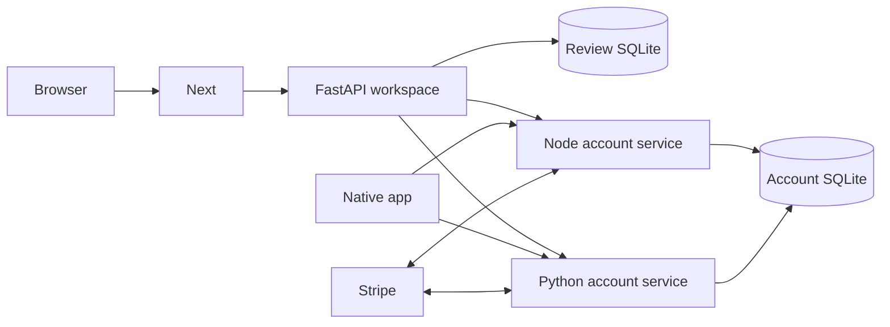

# Backend production review

Scope covers the portable FastAPI workspace, its embedded and standalone account service, and the Node access server. The workspace supports one assigned operator. Both account runtimes use SQLite. The review thread is **InterviewCheck backend production review**.

Use one account runtime per account database. Switching runtimes requires a consistent backup and a stopped writer.

| Pass | Scope | Acceptance |
| --- | --- | --- |
| 1 | `server/src`, `portable/api/account_db.py`, CI | Persist checkout attempts. Apply webhook effects and acknowledgement together. Preserve database compatibility and test rollback. |
| 2 | `portable/api`, backup and account tests | Check recovery, access control, provider failures and operational limits through supported routes. Repair confirmed defects. |
| 3 | Release validation and independent review | Rerun both backends, exercise the production listeners against isolated databases, and record the deployment checks that require a real environment. |

Baseline on `f12bdef` passed 181 portable tests, 68 access server tests, Node type checking, and all 14 detector fixtures. The existing CI workflow built the Node server without running its test suite.

## Review findings and changes

| Finding | Change |
| --- | --- |
| Checkout could create multiple Stripe sessions for one account. | Reserve one checkout per account in SQLite. Reuse the Stripe idempotency key, check existing subscriptions in Stripe, and replace a pending reservation only after Stripe rejects the original expiry. |
| A webhook could persist some writes or reapply stale subscription state. | Apply the subscription, ownership, receipt and audit in one transaction. Check the subscription revision after the Stripe read. Preserve terminal cancellation. |
| A newer expired subscription could hide a valid paid subscription. Legacy renewal could fail when the account's default Stripe customer changed. | Select a subscription that still grants access. Record each subscription's Stripe customer. Permit a known legacy subscription to renew against its verified customer without changing the account default. |
| Public remote access depended on an unverified identity field. | Match both the configured operator email and the operator's account ID. Public remote workspace startup requires the ID. |
| Public embedded sign in shared a single address limit. | Use the client address supplied by an explicitly trusted HTTPS proxy. Keep the shared limit when the address is missing or untrusted. |
| A workspace backup could reject a note retained from a revised answer. | Share the note length limit and accept the revision prefix during restore. Test export, preview, restore and readback. |
| A failed account write could leave a partial signup or administrator change. | Use one transaction for the account update, session change and audit entry. Test rollback after a write failure. |

The Node suite now runs in portable CI. The Node dependency audit and the Python runtime dependency audit found no known vulnerabilities at the time of the local review. The supported account schema upgrades to version 5. Restore a preupgrade backup if the deployment must roll back to the previous runtime. Keep Stripe events received after the backup for reconciliation.

## Local evidence

- 188 Python tests, 80 Node tests, 14 detector fixtures and three production ingress QA tests passed.
- The independent review verified that both runtimes upgrade schema 3 and both interim schema 4 layouts. The tests preserved sessions, grants, webhook receipts and Stripe customer bindings.
- The production Next.js and FastAPI smoke passed HTTP, WebSocket and shutdown checks. A local TLS proxy verified embedded and remote sign in, secure cookies, origin enforcement and replacement of the client address header.
- A fresh portable archive started without Node.js and passed health, embedded sign in and durable interview creation. The smoke builds used the committed frontend while other work was in progress in the shared checkout.

## Release gates

Hold public paid traffic. The principal failure mode is a successful payment followed by missing access.

- Run checkout, duplicate delivery, recovery from a missed event, renewal and cancellation against a Stripe test account through the deployed HTTPS endpoint. Verify that entitlement follows the Stripe state and the return page directs the customer to the correct application. [Stripe webhook documentation](https://docs.stripe.com/webhooks)
- Before a cutover from an older paid deployment, pause checkout. Back up the database, reconcile historical Stripe customer IDs and subscriptions, and let pending Checkout Sessions expire or close them in Stripe. Run the restored database on staging and reconcile Stripe events from the cutover window. [Stripe Checkout Session listing](https://docs.stripe.com/api/checkout/sessions/list)
- For public embedded accounts, configure the trusted HTTPS proxy to replace the client address header. Verify that sign in limits are independent across client addresses and that the proxy replaces values supplied by clients. Verify HTTPS account cookies through the actual proxy.
- Run the Linux and Windows release workflow with these changes. Build the Node container and verify the Fly health probe, volume permissions, restart and backup restore on the target deployment.
